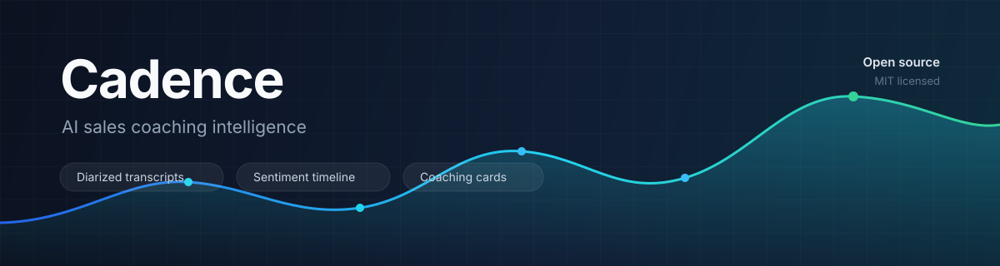
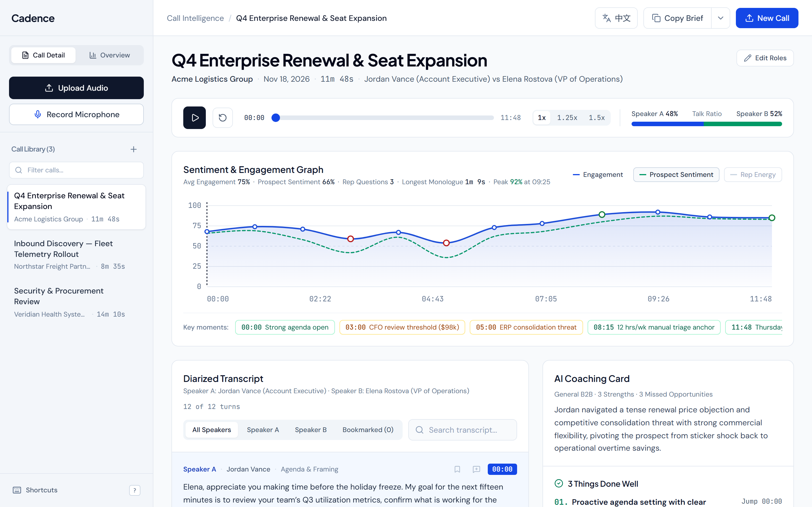
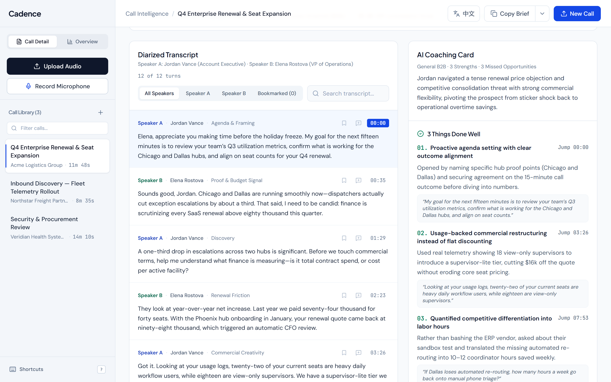
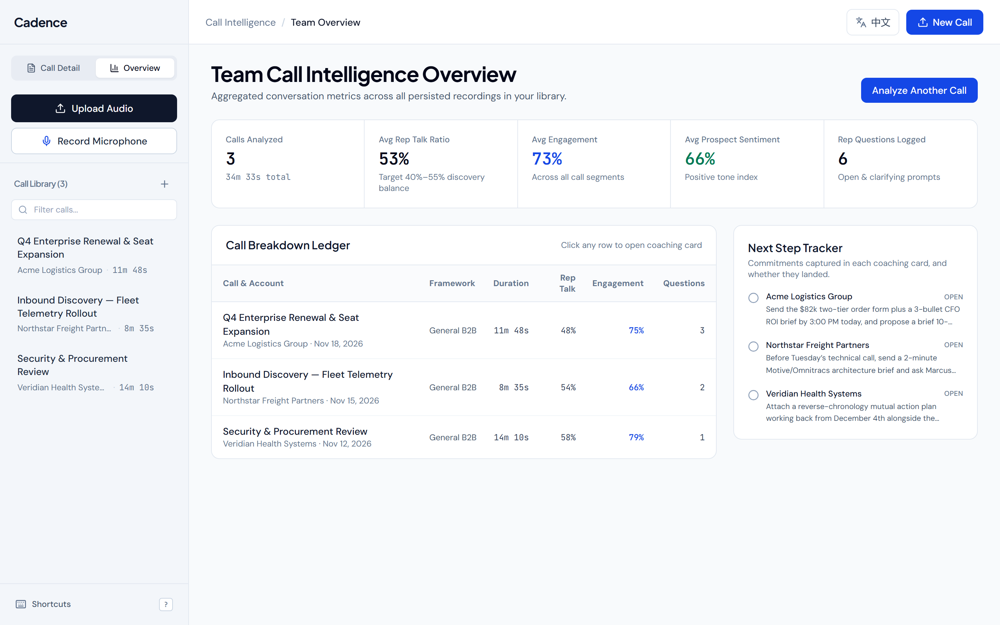
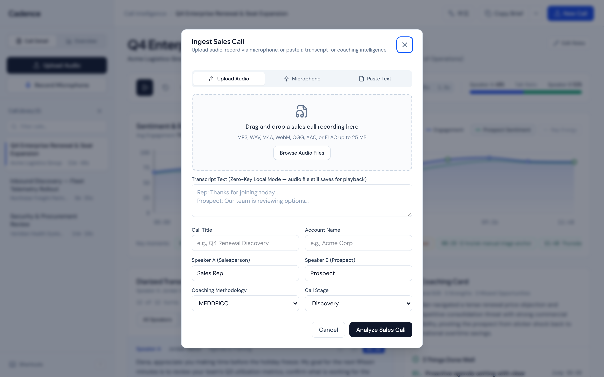
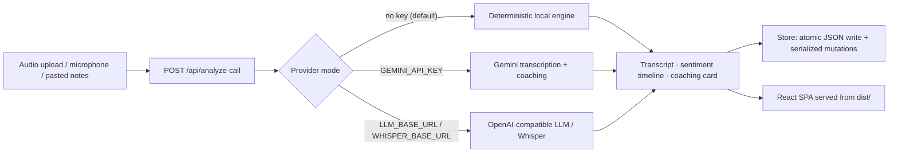

<div align="center">



# Cadence

**Every sales call becomes coaching.**

Speaker-diarized transcripts, sentiment timelines, and evidence-backed coaching cards — served by one Node.js process, with no database and no API key required.

<p>
  <a href="https://github.com/huayuehua15-netizen/yin-shi/actions/workflows/ci.yml"></a>
  
  
  
  
</p>

<p>
  <a href="https://37llsppp9vb45n8fb97.traesite.cn"><strong>Live demo</strong></a>
  &nbsp;·&nbsp;
  <a href="docs/CASE_STUDY.md">Case study</a>
  &nbsp;·&nbsp;
  <a href="#quick-start">Quick start</a>
  &nbsp;·&nbsp;
  <a href="#architecture">Architecture</a>
  &nbsp;·&nbsp;
  <a href="#api">API</a>
</p>

</div>



> **Reviewing this repo?** Start with [`docs/CASE_STUDY.md`](docs/CASE_STUDY.md). It walks through the
> architecture, the concurrency defect in the persistence layer and how it was fixed, the bundle
> split, and the test strategy — roughly a 90-second read, no setup required.

---

## 中文简介

Cadence 是一个开源的 **AI 销售通话分析平台**：上传录音、浏览器实时录制，或粘贴一段通话文本，即可得到

- **双说话人分离的逐字稿**，支持按说话人筛选、关键词搜索、书签与经理批注；
- **互动度与情绪时间线**，叠加关键转折点、话术比例、提问次数与最长独白；
- **AI 教练卡片**，按 MEDDPICC / SPIN / Challenger / 通用 B2B 框架给出 3 条亮点、3 个错失机会（附原文引用与时间戳跳转）以及下一步行动建议。

前后端全 TypeScript：Express 提供 API 并托管生产构建，React + Vite 构建界面。**默认零密钥即可完整运行**，也可以接入 Google Gemini 或任意 OpenAI 兼容接口（如本地 Ollama）。数据只落在本机的 JSON 文件与音频目录，不依赖数据库。

在线体验：<https://37llsppp9vb45n8fb97.traesite.cn>

---

## Why it is worth a look

|                                                 |                                                                                                                                                                           |
| :---------------------------------------------- | :------------------------------------------------------------------------------------------------------------------------------------------------------------------------ |
| **A real product, not a CRUD demo**             | Audio ingestion, diarization, sentiment scoring, coaching generation, exports, bilingual UI, keyboard-first workspace — the full loop works offline.                      |
| **Provider abstraction with graceful fallback** | Gemini, any OpenAI-compatible LLM/Whisper endpoint, or a deterministic local engine. A 503 from a hosted model degrades to local analysis instead of failing the request. |
| **Persistence that survives reality**           | Atomic temp-file + rename writes, serialized read-modify-write cycles, read caching, corruption quarantine, and path-traversal guards.                                    |
| **Engineered, not vibes**                       | Strict TypeScript, ESLint 10 + Prettier, 53 unit tests at ~92% line coverage, a Node 20/22/24 CI matrix, an end-to-end smoke suite, and Docker self-hosting.              |

## Product tour

**Diarized transcript + coaching card.** Every coaching point carries a verbatim quote and a timestamp
that seeks the audio player; bookmarks and manager notes persist through the API.



**Team overview.** Talk-ratio, engagement, prospect sentiment, recurring topics, and a per-call ledger.



**Ingestion.** Upload, record from the microphone, or paste a transcript — each path feeds the same
analysis pipeline.



## Features

| Area                             | What it does                                                                                                                                                                             |
| :------------------------------- | :--------------------------------------------------------------------------------------------------------------------------------------------------------------------------------------- |
| **Multi-source ingestion**       | `.mp3` / `.wav` / `.m4a` / `.webm` / `.ogg` / `.aac` / `.flac` up to 25 MB, browser microphone capture with live speech-to-text, or pasted call notes.                                   |
| **Speaker-diarized transcript**  | Speaker A/B segmentation with filters, keyword search, bookmarks, and persistent manager coaching notes.                                                                                 |
| **Sentiment & engagement graph** | Engagement, prospect sentiment, and rep energy across the timeline, clickable inflection milestones, and a synchronized audio playhead.                                                  |
| **Conversation hygiene**         | Talk-ratio split, rep questions asked, longest monologue, per-call aggregates.                                                                                                           |
| **AI coaching card**             | Framework-aware evaluation: 3 things done well, 3 missed opportunities with verbatim evidence and timestamp jumps, a trackable next step, and follow-up chat grounded in the transcript. |
| **Team overview & exports**      | Multi-call library with averages and recurring topics, plus Markdown / SRT / TXT exports.                                                                                                |
| **Bilingual UI**                 | Instant English / 简体中文 switch persisted in `localStorage`.                                                                                                                           |
| **Zero-key by default**          | A deterministic local analyzer keeps every workflow usable without a key or subscription.                                                                                                |
| **Keyboard-first workspace**     | `?` shortcut panel, `Space` playback, `←` / `→` seek, `J` / `K` library navigation, input-aware guards.                                                                                  |
| **Resilient shell**              | React error boundary, JSON 404s for API routes, security headers, immutable asset caching, PWA manifest, and Open Graph metadata.                                                        |

### Keyboard shortcuts

|    Key    | Action                              |
| :-------: | :---------------------------------- |
|  `Space`  | Play or pause playback              |
| `←` / `→` | Seek backward / forward 5 seconds   |
| `J` / `K` | Next / previous call in the library |
|    `U`    | Open the new call dialog            |
|    `?`    | Toggle the shortcuts panel          |
|   `Esc`   | Close dialogs and menus             |

Shortcuts are suppressed while typing in a text field, and a floating `?` button opens the same panel.

## Architecture



The Express process serves both the API and the production Vite bundle, so one Node.js service hosts
the whole product. Requests flow through a request-id middleware and a latency log; a 503 from the
hosted provider falls back to the local engine rather than failing the call.

### Design decisions

| Decision                  | Why                                                                                                                                                                                                                                      |
| :------------------------ | :--------------------------------------------------------------------------------------------------------------------------------------------------------------------------------------------------------------------------------------- |
| **No database**           | The product is single-tenant and demo-friendly. A JSON document plus atomic writes is inspectable, backup-friendly, and keeps `docker compose up` dependency-free. Concurrency is handled with a per-file write queue instead of hoping. |
| **Zero-key local engine** | Reviewers and self-hosters can run the full flow with no credentials. It also acts as the fallback path when a hosted provider is unavailable.                                                                                           |
| **Single process**        | Removes the need for a queue, a session store, or cross-service auth. The trade-off is documented: horizontal scaling is out of scope.                                                                                                   |
| **Worker-free UI**        | Sentiment graphs are plain SVG with Catmull-Rom smoothing; there is no charting dependency, so the bundle stays small and the graph remains keyboard- and screen-reader-friendly.                                                        |

## Tech stack

| Layer   | Choice                                                                         |
| :------ | :----------------------------------------------------------------------------- |
| UI      | React 19, TypeScript (strict), Tailwind CSS 4, lucide-react, motion            |
| Server  | Express 4, Multer, tsx, Node.js 20+                                            |
| Build   | Vite 8 with explicit vendor chunking                                           |
| AI      | Google Gemini (`@google/genai`) or any OpenAI-compatible chat/Whisper endpoint |
| Quality | ESLint 10 flat config, Prettier, `node:test` via tsx, GitHub Actions           |

## Quick start

```bash
git clone https://github.com/huayuehua15-netizen/yin-shi.git
cd yin-shi
npm install
npm run dev
```

Open <http://localhost:3000>. The workspace boots with three seeded calls and works immediately in
Zero-Key Local mode.

Production build:

```bash
npm run build
npm start        # cross-env NODE_ENV=production tsx server.ts, works on Windows/macOS/Linux
```

Everyday scripts:

| Command                 | Purpose                                                  |
| :---------------------- | :------------------------------------------------------- |
| `npm run dev`           | Express + Vite middleware with HMR                       |
| `npm run build`         | Production bundle into `dist/`                           |
| `npm test`              | Unit tests (`node:test`)                                 |
| `npm run test:coverage` | Tests with the built-in coverage report                  |
| `npm run lint`          | ESLint + `tsc --noEmit`                                  |
| `npm run verify`        | Format check, lint, tests, build — the same gate CI runs |

## AI provider modes

| Mode                           | Configuration                                                                                | Capabilities                                                                                                                                |
| :----------------------------- | :------------------------------------------------------------------------------------------- | :------------------------------------------------------------------------------------------------------------------------------------------ |
| **Zero-key local** (default)   | none                                                                                         | Paste-text analysis, browser speech-to-text recording, deterministic diarization, sentiment scoring, 3+3 coaching cards, follow-up coaching |
| **Google Gemini**              | `GEMINI_API_KEY`                                                                             | Audio transcription and LLM coaching                                                                                                        |
| **OpenAI-compatible / Ollama** | `LLM_BASE_URL`, `LLM_MODEL`, `OPENAI_API_KEY`, optional `WHISPER_BASE_URL` / `WHISPER_MODEL` | Self-hosted LLM analysis and Whisper transcription                                                                                          |

Force a provider with `CADENCE_PROVIDER=local` (useful for demos and for keeping recordings on-device).

## Configuration

Copy `.env.example` to `.env` (never commit `.env`):

| Variable           | Default     | Description                                                     |
| :----------------- | :---------- | :-------------------------------------------------------------- |
| `GEMINI_API_KEY`   | —           | Enables Gemini transcription and coaching                       |
| `LLM_BASE_URL`     | —           | OpenAI-compatible base URL, e.g. `http://localhost:11434/v1`    |
| `LLM_MODEL`        | —           | Model name for the compatible endpoint                          |
| `OPENAI_API_KEY`   | —           | Key for the compatible endpoint (use `ollama` for local Ollama) |
| `WHISPER_BASE_URL` | —           | OpenAI-compatible Whisper endpoint for audio transcription      |
| `WHISPER_MODEL`    | `whisper-1` | Whisper model name                                              |
| `CADENCE_PROVIDER` | `auto`      | `auto`, `local`, `gemini`, or `openai-compatible`               |
| `PORT`             | `3000`      | HTTP port for the Express + Vite server                         |
| `CADENCE_DATA_DIR` | `./data`    | Directory for `calls.json` and uploaded audio                   |

## API

| Method   | Endpoint               | Description                                                  |
| :------- | :--------------------- | :----------------------------------------------------------- |
| `GET`    | `/api/health`          | Health check: uptime, version, active provider               |
| `GET`    | `/api/capabilities`    | Active provider mode and transcription support               |
| `GET`    | `/api/calls`           | List persisted call records                                  |
| `PATCH`  | `/api/calls/:id`       | Update speaker labels, bookmarks, notes, or next-step status |
| `DELETE` | `/api/calls/:id`       | Delete a call and its uploaded audio                         |
| `GET`    | `/api/audio/:filename` | Stream uploaded audio with HTTP `Range` support              |
| `POST`   | `/api/transcribe`      | Transcribe uploaded or recorded audio                        |
| `POST`   | `/api/analyze-call`    | Run diarization, sentiment timeline, and coaching pipeline   |
| `POST`   | `/api/coach-chat`      | Follow-up coaching grounded in the call transcript           |

Every response carries `X-Request-Id`; unknown API routes return JSON 404s instead of the SPA shell.

## Deployment

### Docker

```bash
cp .env.example .env
# Optional: set GEMINI_API_KEY or LLM_BASE_URL in .env
docker compose up -d --build
```

The service listens on <http://localhost:3000> and exposes `/api/health`. Records and audio persist in
the mounted `./data` volume.

### Any Node.js 20 host

```bash
npm ci
npm run build
PORT=3000 CADENCE_DATA_DIR=/var/lib/cadence npm start
```

Keep `CADENCE_DATA_DIR` on a writable volume: it holds `calls.json` and uploaded audio. If the filesystem
is ephemeral, call history resets on restart or redeploy.

## Testing & quality

```bash
npm test              # 53 unit tests: analytics, local analyzer, store, provider normalization, fallback strategy, API client, focus trap, shortcuts, i18n
npm run test:coverage # ~92.5% line / ~80.9% branch coverage
npm run smoke         # boots the real server, 11 end-to-end API checks
npm run lint          # ESLint (flat config) + tsc --noEmit in strict mode
npm run format:check  # Prettier
```

What the suite actually protects:

- **Persistence**: CRUD round-trips, atomic writes with no temp-file leaks, concurrent `addCallRecord`
  calls, concurrent field updates, corruption quarantine, and "an empty store stays empty".
- **Local engine**: diarization, sentiment classification, coaching card shape, and follow-up replies.
- **Provider normalization**: a shared post-processing layer that repairs whatever an LLM returns —
  clamping scores, sorting the timeline, forcing exactly three coaching points, dropping blank turns,
  and rejecting nothing (an empty payload still yields a valid card).
- **Fallback strategy**: a provider answering 503 / UNAVAILABLE degrades to the local engine, while
  permission, validation and auth errors still surface instead of being silently swallowed.
- **API client**: envelope unwrapping, JSON vs. multipart bodies, offline detection, and error mapping.
- **Dialog keyboard behaviour**: Tab and Shift+Tab wrap inside the modal, focus lands on the first
  control, and focus returns to the trigger on close.
- **Pure analytics**: talk ratio, engagement summaries, conversation metrics, exports, and shortcuts.
- **End-to-end contract** (`npm run smoke`): the real server against a temporary data directory —
  static hosting, asset serving, health, CRUD persistence, the zero-key analysis pipeline, JSON 404s,
  and path-traversal rejection.

CI runs format, lint/typecheck, tests, and a production build on **Node 20, 22, and 24**; a separate
coverage job publishes the report as a build artifact, a second job boots the built server and runs
the smoke suite, and a guard fails the build if the emitted CSS loses its Tailwind utilities.

## Project structure

```text
├── server.ts                   # Entry point: boot, listen, graceful shutdown (34 lines)
├── server/
│   ├── app.ts                  # Express composition: headers, logging, routing, Vite/static host
│   ├── config.ts               # Env probes, provider capabilities, mime + enum resolution
│   ├── errors.ts               # Provider failure → HTTP status mapping
│   ├── analysis/
│   │   ├── types.ts            # AnalysisMeta / AnalysisResult contracts
│   │   ├── normalize.ts        # Shared post-processing (clamping, sorting, backfilling)
│   │   ├── normalize.test.ts
│   │   ├── fallback.ts         # 503/UNAVAILABLE → local engine, in one tested seam
│   │   ├── fallback.test.ts
│   │   ├── gemini.ts           # Gemini client, transcription, structured-schema analysis
│   │   └── openai.ts           # OpenAI-compatible transcription, analysis, coach chat
│   ├── routes/
│   │   ├── calls.ts            # Call library CRUD + Range-enabled audio streaming
│   │   ├── transcribe.ts       # POST /api/transcribe
│   │   ├── analyzeCall.ts      # POST /api/analyze-call (ingestion pipeline)
│   │   ├── coachChat.ts        # POST /api/coach-chat
│   │   └── upload.ts           # Shared multipart upload type
│   ├── localAnalyzer.ts        # Zero-key deterministic diarization & coaching engine
│   ├── localAnalyzer.test.ts
│   ├── store.ts                # Atomic JSON persistence, write queue, safe audio paths
│   └── store.test.ts
├── src/
│   ├── api/client.ts           # Typed API client + ApiError contract
│   ├── components/             # Sentiment graph, transcript, coaching card, overview, ingestion modal
│   ├── data/sampleCalls.ts     # Seeded, realistic B2B calls
│   ├── hooks/useDialogFocus.ts # Focus trap, initial focus, and focus restore
│   ├── i18n/translations.ts    # English & Simplified Chinese dictionary
│   ├── types/call.ts           # Shared domain types
│   └── utils/                  # Pure analytics, exports, keyboard + tab traversal
├── docs/
│   ├── CASE_STUDY.md           # Architecture decisions and the concurrency fix
│   ├── screenshots/            # README captures, regenerated by scripts/capture-docs.mjs
│   ├── banner.svg              # Repository banner
│   └── social-preview.png      # GitHub social preview (1280×640)
├── scripts/
│   ├── capture-docs.mjs        # Reproducible screenshot pipeline (Puppeteer + local Chrome)
│   └── smoke.mjs               # Boots the server and runs 11 end-to-end API checks
├── public/                     # Favicon, PWA manifest, robots.txt, Open Graph cover
├── .github/workflows/ci.yml    # Node matrix, coverage artifact, CSS sanity guard
├── Dockerfile                  # Multi-stage self-hosting image
└── docker-compose.yml          # One-command local / server deployment
```

## Roadmap

- [ ] Streaming transcription so long calls render progressively
- [ ] Object storage adapter behind the same store interface (S3-compatible)
- [ ] Optional basic auth / reverse-proxy recipe for public deployments
- [ ] Snapshot tests for the coaching card and sentiment graph
- [ ] Export to CRM-shaped JSON (Salesforce / HubSpot field mapping)

## Contributing

Contributions are welcome — please read [CONTRIBUTING.md](./CONTRIBUTING.md) and
[CODE_OF_CONDUCT.md](./CODE_OF_CONDUCT.md) first. Commit messages use concise Chinese bracket tags
(`[新增]`, `[修复]`, `[更新]`, `[重构]`, `[文档]`, `[测试]`); enable the template locally with:

```bash
git config commit.template .gitmessage
```

Security reports go through GitHub's private advisory flow — see [SECURITY.md](./SECURITY.md).

## License

[MIT](./LICENSE)
