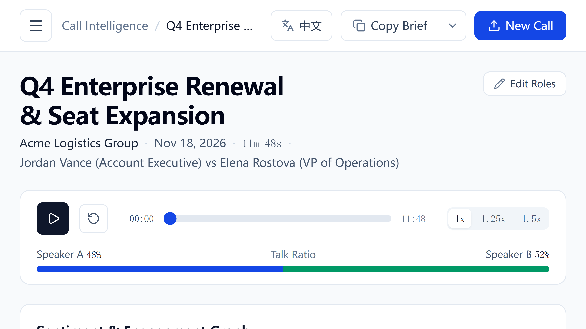
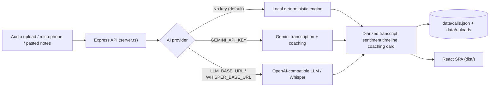

<div align="center">


# Cadence

**Turn recorded sales conversations into speaker-diarized transcripts, sentiment timelines, and actionable coaching cards.**

<p>
  
  
  
  
  
  
  
</p>

<p>
  <a href="https://37llsppp9vb45n8fb97.traesite.cn"><strong>Live Demo</strong></a>
  &nbsp;·&nbsp;
  <a href="#features">Features</a>
  &nbsp;·&nbsp;
  <a href="#quick-start">Quick Start</a>
  &nbsp;·&nbsp;
  <a href="#api">API</a>
  &nbsp;·&nbsp;
  <a href="#deployment">Deployment</a>
</p>

</div>



---

## 中文简介

Cadence 是一个开源的 **AI 销售通话分析平台**。上传录音、用浏览器直接录制，或粘贴一段通话文本，它会产出：

- **双说话人分离的逐字稿**（Speaker A / Speaker B），支持按说话人筛选、关键词搜索、书签和经理批注
- **互动度与情绪时间线**，叠加关键转折点、话术比例、提问次数和最长独白
- **AI 教练卡片**，按 MEDDPICC / SPIN / Challenger / 通用 B2B 框架给出 3 条亮点、3 个错失机会（带原文引用与时间戳跳转）以及下一步行动建议

前后端均为 TypeScript：Express 提供 API，React + Vite 构建界面。**默认零密钥即可运行**，也可以接入 Google Gemini 或任意 OpenAI 兼容接口（如本地 Ollama）。

在线体验：<https://37llsppp9vb45n8fb97.traesite.cn>

---

## Features

| Area | What it does |
| :--- | :--- |
| **Multi-source ingestion** | Upload `.mp3` / `.wav` / `.m4a` / `.webm` / `.ogg` / `.aac` / `.flac` (up to 25 MB), record from the microphone, or paste raw call notes. |
| **Speaker-diarized transcript** | Speaker A / B segmentation with speaker filters, keyword search, bookmarks, and persistent manager coaching notes. |
| **Sentiment & engagement graph** | Engagement, prospect sentiment, and rep energy across the call timeline, with clickable inflection milestones and a synchronized audio playhead. |
| **Conversation hygiene** | Talk-ratio split, rep questions asked, longest monologue, and per-call aggregates. |
| **AI coaching card** | Framework-aware evaluation (MEDDPICC, SPIN Selling, Challenger, General B2B): 3 things done well, 3 missed opportunities with verbatim evidence and timestamp jumps, a trackable next step, and inline follow-up coaching. |
| **Team overview & exports** | Multi-call library with average talk ratio, engagement, prospect sentiment, recurring topic breakdown, plus Markdown / SRT / TXT exports. |
| **Bilingual UI** | Instant English / 简体中文 switcher persisted in `localStorage`. |
| **Zero-key by default** | A deterministic local analyzer keeps every workflow usable without an API key or subscription. |

## Architecture



The Express process serves both the API and the production Vite bundle, so a single Node.js service is enough to host the whole product.

## Quick Start

```bash
git clone https://github.com/huayuehua15-netizen/yin-shi.git
cd yin-shi
npm install --legacy-peer-deps
npm run dev
```

Open <http://localhost:3000>.

> `--legacy-peer-deps` is required because the repository pins `esbuild@^0.25` as a dev dependency while Vite 8 expects `^0.27 || ^0.28`. If you use Bun, `bun install` works with the committed `bun.lock`.

Production build:

```bash
npm run build
npm start          # NODE_ENV=production tsx server.ts (Linux / macOS)
```

On Windows, run `set NODE_ENV=production&& npx tsx server.ts` or use Docker (see below).

## AI Provider Modes

| Mode | Configuration | Capabilities |
| :--- | :--- | :--- |
| **Zero-key local** (default) | none | Paste-text analysis, browser speech-to-text recording, deterministic diarization, sentiment scoring, 3+3 coaching cards, follow-up coaching |
| **Google Gemini** | `GEMINI_API_KEY` | Audio transcription (`gemini-3.5-transcribe`) and LLM coaching (`gemini-4-hydrogen`) |
| **OpenAI-compatible / Ollama** | `LLM_BASE_URL`, `LLM_MODEL`, `OPENAI_API_KEY`, optional `WHISPER_BASE_URL` / `WHISPER_MODEL` | Self-hosted LLM analysis and Whisper transcription |

## Configuration

Copy `.env.example` to `.env` (never commit `.env`):

| Variable | Default | Description |
| :--- | :--- | :--- |
| `GEMINI_API_KEY` | — | Enables Gemini transcription and coaching |
| `LLM_BASE_URL` | — | OpenAI-compatible base URL, e.g. `http://localhost:11434/v1` |
| `LLM_MODEL` | — | Model name for the compatible endpoint |
| `OPENAI_API_KEY` | — | Key for the compatible endpoint (use `ollama` for local Ollama) |
| `WHISPER_BASE_URL` | — | OpenAI-compatible Whisper endpoint for audio transcription |
| `WHISPER_MODEL` | `whisper-1` | Whisper model name |
| `PORT` | `3000` | HTTP port for the Express + Vite server |
| `CADENCE_DATA_DIR` | `./data` | Directory for `calls.json` and uploaded audio |

## API

| Method | Endpoint | Description |
| :--- | :--- | :--- |
| `GET` | `/api/health` | Health check |
| `GET` | `/api/capabilities` | Active provider mode and transcription support |
| `GET` | `/api/calls` | List persisted call records |
| `PATCH` | `/api/calls/:id` | Update speaker labels, bookmarks, notes, or next-step status |
| `DELETE` | `/api/calls/:id` | Delete a call and its uploaded audio |
| `GET` | `/api/audio/:filename` | Stream uploaded audio with HTTP `Range` support |
| `POST` | `/api/transcribe` | Transcribe uploaded or recorded audio |
| `POST` | `/api/analyze-call` | Run diarization, sentiment timeline, and coaching pipeline |
| `POST` | `/api/coach-chat` | Follow-up coaching grounded in the call transcript |

## Deployment

### Docker

```bash
cp .env.example .env
# Optional: set GEMINI_API_KEY or LLM_BASE_URL in .env
docker compose up -d --build
```

The service listens on <http://localhost:3000> and exposes `/api/health`. Records and audio are persisted in the mounted `./data` volume.

### Any Node.js 20 host

```bash
npm install --legacy-peer-deps
npm run build
PORT=3000 CADENCE_DATA_DIR=/var/lib/cadence npm start
```

Keep `CADENCE_DATA_DIR` on a writable volume: it holds `calls.json` and uploaded audio. If the filesystem is ephemeral, call history resets on restart or redeploy.

## Project Structure

```text
├── server.ts                  # Express API + production static host
├── server/
│   ├── localAnalyzer.ts       # Zero-key deterministic diarization & coaching engine
│   └── store.ts               # JSON persistence (calls.json) and audio storage
├── src/
│   ├── App.tsx                # Workspace controller
│   ├── components/            # Sentiment graph, transcript, coaching card, team overview, upload modal
│   ├── data/sampleCalls.ts    # Pre-seeded realistic B2B sales calls
│   ├── i18n/translations.ts   # English & Simplified Chinese dictionary
│   ├── types/call.ts          # Shared TypeScript interfaces
│   └── utils/callAnalytics.ts # Talk ratio, hygiene metrics, overview & export formatters
├── docs/                      # Banner and screenshots used by this README
├── Dockerfile                 # Container image for self-hosting
├── docker-compose.yml         # One-command local / server deployment
├── .github/workflows/ci.yml   # CI: test, typecheck, build
└── metadata.json              # App metadata for AI Studio
```

## Testing & CI

```bash
npm test        # Node test runner: analytics, analyzer, store persistence
npm run lint    # tsc --noEmit
npm run build   # Vite production bundle
```

Every push and pull request to `main` runs the same three checks through GitHub Actions.

## Contributing

Contributions are welcome. Please read [CONTRIBUTING.md](./CONTRIBUTING.md) first. Commit messages follow concise Chinese bracket tags: `[新增]`, `[修复]` / `[bug]`, `[更新]`, `[重构]`, `[文档]`, `[测试]`. Enable the template locally with:

```bash
git config commit.template .gitmessage
```

## License

[MIT](./LICENSE)
